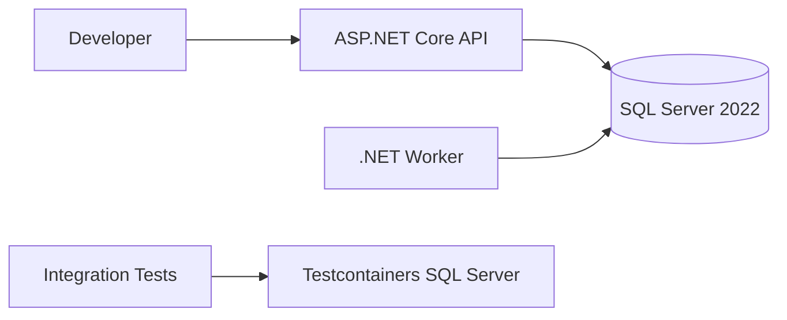
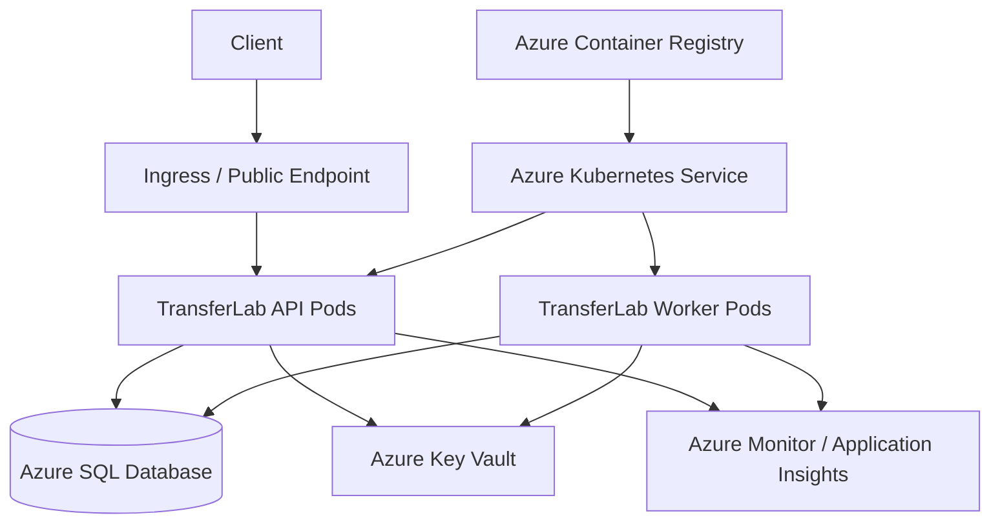

# TransferLab

TransferLab is a small financial transaction-processing system built as a hands-on .NET engineering, containerization, Kubernetes, and Microsoft Azure migration lab.

The project intentionally begins as a locally hosted application backed by SQL Server and is being incrementally evolved toward a cloud-native deployment in Microsoft Azure.

The goal is not simply to deploy an application to the cloud.

The goal is to exercise and document the engineering decisions involved in migrating an existing service from an on-premises-style environment to Azure while preserving application behavior, data integrity, testability, operational visibility, deployment safety, and rollback capability.

TransferLab uses a synthetic account-transfer domain. It does not integrate with real banks, payment networks, customer accounts, or financial institutions.

---

## Why This Project Exists

Cloud migration is more than changing a connection string or moving an application into a container.

A production migration typically requires understanding:

- application dependencies
- data ownership
- transactional behavior
- configuration and secrets
- deployment topology
- failure modes
- health checks
- observability
- migration validation
- rollback strategy
- infrastructure differences
- CI/CD behavior
- operational support requirements

TransferLab provides a controlled environment for practicing those concerns with a small enough system to understand end-to-end.

A core migration principle for the project is:

> Separate infrastructure migration risk from application modernization risk wherever practical.

The application will therefore evolve incrementally rather than being rewritten during the migration.

---

# Architecture

TransferLab follows a layered architecture with clear separation between domain behavior, application use cases, infrastructure concerns, and executable hosts.

```text
Domain
  ↑
Application
  ↑
Infrastructure
  ↑
API / Worker
```

### TransferLab.Domain

Contains business entities, state transitions, and domain rules.

The Domain project has no dependency on Entity Framework Core, ASP.NET Core, SQL Server, Docker, or Azure.

Current entities include:

- `Account`
- `Transfer`
- `TransferStatus`

Examples of domain rules include:

- account balances cannot begin below zero
- credit and debit amounts must be positive
- accounts cannot be overdrawn
- a transfer cannot target the same source and destination account
- transfer state transitions are explicitly controlled

Current transfer lifecycle:

```text
Pending
   ↓
Processing
   ├──→ Completed
   └──→ Failed
```

---

### TransferLab.Application

Contains application use cases and abstractions.

Current application operations include:

```text
CreateAccount
CreateTransfer
ProcessTransfer
```

The Application project defines persistence abstractions such as:

```text
IAccountRepository
ITransferRepository
IUnitOfWork
```

The application layer depends on abstractions rather than Entity Framework Core or SQL Server directly.

---

### TransferLab.Infrastructure

Contains persistence and other infrastructure-specific implementations.

Current infrastructure includes:

```text
Entity Framework Core
SQL Server provider
TransferLabDbContext
entity mappings
EF Core migrations
```

Repository implementations will be added here as the persistence layer is completed.

---

### TransferLab.Api

ASP.NET Core host for the HTTP API.

The API is also currently used as the EF Core startup project for configuration and dependency injection during migration operations.

The public HTTP API surface will be implemented incrementally.

---

### TransferLab.Worker

Background processing host intended to process pending transfers asynchronously.

The initial implementation will use database-backed work discovery.

A later phase may introduce Azure Service Bus to explore asynchronous messaging, retries, duplicate delivery, dead-letter handling, and idempotent consumers.

---

# Current Repository Structure

```text
TransferLab/
├── .config/
│   └── dotnet-tools.json
│
├── docker/
│   └── docker-compose.yml
│
├── docs/
│
├── src/
│   ├── TransferLab.Api/
│   ├── TransferLab.Application/
│   ├── TransferLab.Domain/
│   ├── TransferLab.Infrastructure/
│   └── TransferLab.Worker/
│
├── tests/
│   ├── TransferLab.UnitTests/
│   └── TransferLab.IntegrationTests/
│
├── .env.example
├── .gitignore
├── README.md
└── TransferLab.sln
```

---

# Current Technology Stack

| Area | Technology |
|---|---|
| Language | C# |
| Runtime | .NET 10 |
| API | ASP.NET Core |
| Persistence | Entity Framework Core |
| Database | SQL Server 2022 |
| Unit Testing | xUnit |
| Integration Testing | xUnit + Testcontainers |
| Local Infrastructure | Docker / Docker Compose |
| EF Tooling | repo-local `dotnet-ef` |
| IDE | JetBrains Rider / VS Code |
| Source Control | Git / GitHub |

Planned cloud technologies include:

```text
Azure SQL Database
Azure Kubernetes Service
Azure Container Registry
Azure Key Vault
Azure Managed Identity
Azure Monitor
Application Insights
GitHub Actions
Azure Service Bus
```

---

# Persistence Model

TransferLab currently persists two primary entities.

## Accounts

```text
Accounts
--------------------------------
Id        uniqueidentifier   PK
Name      nvarchar(200)
Balance   decimal(18,2)
```

Money values are explicitly mapped using:

```text
decimal(18,2)
```

rather than relying on provider defaults.

---

## Transfers

```text
Transfers
---------------------------------------------
Id                      uniqueidentifier   PK
SourceAccountId         uniqueidentifier
DestinationAccountId    uniqueidentifier
Amount                  decimal(18,2)
Status                  nvarchar(50)
CreatedUtc              datetimeoffset
```

`SourceAccountId` and `DestinationAccountId` reference `Accounts`.

Delete behavior is restricted so deleting an account cannot cascade-delete transfer history.

Indexes currently exist on:

```text
SourceAccountId
DestinationAccountId
Status
```

Transfer status is stored as a readable string rather than the numeric value of the C# enum.

Example:

```text
Pending
Processing
Completed
Failed
```

instead of:

```text
0
1
2
3
```

---

# Entity Framework Core

Entity mappings are explicitly configured rather than relying entirely on EF Core conventions.

Configuration classes are stored under:

```text
src/TransferLab.Infrastructure/Persistence/Configurations/
```

Current mappings include:

```text
AccountConfiguration
TransferConfiguration
```

The EF Core context is:

```text
TransferLabDbContext
```

Migrations are stored under:

```text
src/TransferLab.Infrastructure/Persistence/Migrations/
```

The repository currently contains an initial migration that creates:

```text
Accounts
Transfers
__EFMigrationsHistory
```

---

# Local Development Architecture

The current local environment represents the starting point of the migration lab.



The persistent development database runs through Docker Compose.

Integration tests do **not** use the persistent development database.

Instead, Testcontainers creates a disposable SQL Server instance for the test run.

---

# Developer Setup

These setup instructions have been validated using a second MacBook with a fresh operating system and a clean clone of the repository.

The goal is for a new developer to be able to clone the repository and reach a working build without relying on undocumented machine-specific knowledge.

## Prerequisites

Install:

- Git
- .NET 10 SDK
- Docker Desktop
- JetBrains Rider or VS Code

GitHub CLI is optional but useful.

Verify the environment:

```bash
git --version
dotnet --version
docker --version
docker compose version
```

Docker Desktop must also be running:

```bash
docker info
```

On macOS:

```bash
open -a Docker
```

---

## Apple Silicon

SQL Server's Linux container currently runs as an `amd64` image.

The Docker Compose configuration therefore explicitly specifies:

```yaml
platform: linux/amd64
```

Docker Desktop handles the required emulation on Apple Silicon.

TransferLab development and integration testing have been validated on an ARM64 Mac.

---

# Clone the Repository

Using SSH:

```bash
git clone git@github.com:JLo3D/transferlab.git
cd transferlab
```

If using GitHub CLI:

```bash
gh repo clone JLo3D/transferlab
cd transferlab
```

---

# Restore, Build, and Test

Restore repository-local .NET tools:

```bash
dotnet tool restore
```

Restore NuGet dependencies:

```bash
dotnet restore
```

Build the entire solution:

```bash
dotnet build
```

Run all tests:

```bash
dotnet test
```

A fresh clone should be able to restore and build without requiring the persistent development database.

---

# Automated Tests

TransferLab currently contains both unit tests and SQL Server integration tests.

## Unit Tests

Unit tests verify domain and application behavior without requiring infrastructure.

Run them with:

```bash
dotnet test tests/TransferLab.UnitTests
```

Current test coverage includes behavior such as:

```text
Account creation
Account credit
Account debit
Insufficient funds
Transfer creation
Transfer state transitions
Application command handlers
Failed transfer handling
Unit of Work interaction
```

---

## Integration Tests

Integration tests use Testcontainers to start a temporary SQL Server instance.

The test process:

```text
Start temporary SQL Server container
        ↓
Create TransferLabDbContext
        ↓
Apply real EF Core migrations
        ↓
Write data using EF Core
        ↓
Clear EF change tracking
        ↓
Read data back from SQL Server
        ↓
Assert persisted values
        ↓
Destroy temporary container
```

Run the integration tests with:

```bash
dotnet test tests/TransferLab.IntegrationTests
```

Docker must be running.

The persistent local `transferlab-sql` database does not need to be running.

Integration tests do not require `.env`.

Integration tests do not modify the developer's local TransferLab database.

---

# Persistent Local SQL Server

A persistent SQL Server 2022 instance is provided for local application development through Docker Compose.

The configuration is located at:

```text
docker/docker-compose.yml
```

Local database credentials are not committed to source control.

---

## Local Environment File

Create your local configuration from the committed template:

```bash
cp .env.example .env
```

The template contains:

```env
MSSQL_SA_PASSWORD=CHANGE_ME_TO_A_STRONG_LOCAL_PASSWORD
```

Replace the placeholder with a strong local development password.

The `.env` file is ignored by Git.

Do not commit it.

The Docker Compose configuration should fail immediately if the required password is missing rather than allowing SQL Server to start with invalid configuration.

---

## Start SQL Server

```bash
docker compose   --env-file .env   -f docker/docker-compose.yml   up -d
```

Verify:

```bash
docker ps
```

View startup logs:

```bash
docker logs transferlab-sql --tail 50
```

A healthy startup includes:

```text
SQL Server is now ready for client connections
```

---

## Stop SQL Server

Preserve the database volume:

```bash
docker compose   --env-file .env   -f docker/docker-compose.yml   down
```

Destroy the database volume as well:

```bash
docker compose   --env-file .env   -f docker/docker-compose.yml   down -v
```

`down -v` permanently removes the local SQL Server data volume.

---

# Local Database Connection

The development database is exposed at:

```text
Host:     localhost
Port:     1433
Database: TransferLab
User:     sa
```

The password comes from `.env`.

---

# Application Secrets

The application connection string is stored using .NET User Secrets rather than being committed to `appsettings.json`.

Initialize User Secrets if required:

```bash
dotnet user-secrets init   --project src/TransferLab.Api
```

Set the local connection string:

```bash
dotnet user-secrets set   "ConnectionStrings:TransferLab"   "Server=localhost,1433;Database=TransferLab;User Id=sa;Password=YOUR_PASSWORD;Encrypt=True;TrustServerCertificate=True"   --project src/TransferLab.Api
```

Credentials and connection strings containing passwords should never be committed to source control.

---

# Database Migrations

The EF CLI is installed as a repository-local .NET tool.

Restore tools:

```bash
dotnet tool restore
```

Verify EF:

```bash
dotnet tool run dotnet-ef --version
```

---

## Apply Migrations

Start SQL Server first, configure User Secrets, then run:

```bash
ASPNETCORE_ENVIRONMENT=Development dotnet tool run dotnet-ef database update   --project src/TransferLab.Infrastructure   --startup-project src/TransferLab.Api
```

---

## Create a Migration

After changing the persistence model:

```bash
ASPNETCORE_ENVIRONMENT=Development dotnet tool run dotnet-ef migrations add MigrationName   --project src/TransferLab.Infrastructure   --startup-project src/TransferLab.Api   --output-dir Persistence/Migrations
```

Generated migrations should be reviewed before they are applied.

---

# Planned HTTP API

The intended public API surface is:

```text
POST /api/accounts
GET  /api/accounts/{id}

POST /api/transfers
GET  /api/transfers/{id}

GET  /api/accounts/{id}/transactions

GET  /health/live
GET  /health/ready
```

These endpoints are part of the project roadmap and should not be assumed to be complete until implemented.

---

# Planned Transfer Processing

The intended processing flow is:

```text
Client
  ↓
POST /api/transfers
  ↓
Transfer created as Pending
  ↓
Worker discovers pending transfer
  ↓
Transfer → Processing
  ↓
Debit source account
  ↓
Credit destination account
  ↓
Transfer → Completed
```

Failures transition the transfer to:

```text
Failed
```

A later iteration will strengthen this flow with explicit transactional guarantees so account balance updates and transfer state changes commit atomically.

---

# Idempotency

Transfer submission will eventually support an idempotency key:

```http
Idempotency-Key: <unique-value>
```

The objective is to ensure that retries caused by timeouts, network failures, or client behavior cannot accidentally create duplicate transfers.

This becomes especially important when asynchronous messaging is introduced.

---

# Target Azure Architecture

The eventual Azure deployment is expected to resemble:



Future iterations may introduce Azure Service Bus between the API and worker.

---

# Migration Strategy

TransferLab is intended to model an incremental migration rather than a rewrite.

The migration sequence is expected to follow:

```text
1. Establish working local baseline
2. Document dependencies and behavior
3. Add automated tests
4. Containerize application components
5. Externalize configuration and secrets
6. Provision Azure infrastructure
7. Migrate SQL Server workload to Azure SQL
8. Publish container images to ACR
9. Deploy application services to AKS
10. Validate behavior in parallel
11. Introduce health checks and observability
12. Exercise deployment and rollback
13. Perform controlled cutover
14. Compare post-migration behavior against baseline
```

The objective is to isolate infrastructure changes from application changes wherever possible.

---

# Kubernetes Scope

The AKS phase will provide hands-on experience with:

```text
Pods
Deployments
Services
Ingress
Namespaces
ConfigMaps
Secrets
Readiness probes
Liveness probes
Scaling
Rollouts
Rollback
Logs
Resource inspection
```

Operational exercises will include commands such as:

```bash
kubectl get pods
kubectl get deployments
kubectl get services
kubectl describe pod <pod>
kubectl logs <pod>
kubectl rollout status deployment/<deployment>
kubectl rollout undo deployment/<deployment>
```

---

# CI/CD Roadmap

GitHub Actions will eventually automate:

```text
Restore
Build
Unit tests
Integration tests
Container build
Container publishing
Azure authentication
AKS deployment
Migration validation
Deployment verification
```

Container images will be published to Azure Container Registry.

Deployment credentials should use identity-based authentication wherever practical rather than long-lived secrets.

---

# Observability Roadmap

TransferLab will progressively add:

```text
Structured logging
Correlation identifiers
Request tracing
Application metrics
Database diagnostics
Readiness checks
Liveness checks
Azure Monitor
Application Insights
Potential Datadog integration
```

The migration will not be considered successful merely because the application starts.

It must also be possible to determine whether it is healthy and behaving correctly.

---

# Rollback

Rollback capability is a first-class concern of the project.

Deployment exercises will include:

```text
Known-good container versions
Kubernetes rollout history
Kubernetes rollout undo
Database migration review
Backward-compatible application changes
Pre/post migration validation
Health monitoring during cutover
```

Infrastructure migration should not eliminate the ability to return to a previously known-good state.

---

# Fresh-Machine Validation

TransferLab is periodically tested from a clean development environment.

A fresh developer machine should be able to reach a working build using roughly:

```bash
git clone git@github.com:JLo3D/transferlab.git
cd transferlab

dotnet tool restore
dotnet restore
dotnet build
dotnet test
```

Persistent local development infrastructure should require only:

```bash
cp .env.example .env
# configure MSSQL_SA_PASSWORD

docker compose   --env-file .env   -f docker/docker-compose.yml   up -d
```

The application database can then be configured with .NET User Secrets and initialized using EF Core migrations.

If a new developer must remember an undocumented machine-specific step, that should be treated as a developer-experience defect and either documented or automated.

---

# Current Status

TransferLab currently has:

```text
.NET 10 solution architecture
Domain entities and domain validation
Transfer state machine
Application command handlers
Persistence abstractions
Unit of Work abstraction
EF Core DbContext
Explicit EF Core entity mappings
SQL Server 2022 Docker environment
EF Core initial migration
Persistent local TransferLab database
Unit test suite
SQL Server integration testing with Testcontainers
Repo-local EF tooling
Fresh-machine onboarding validation
```

The next implementation phase is:

```text
EF-backed repository implementations
Unit of Work implementation
Dependency injection registration
HTTP API endpoints
Worker execution
Transaction handling
Additional integration tests
```

---

# Project Philosophy

TransferLab is intentionally built in stages.

The purpose is not to hide infrastructure behind automation before understanding it.

Each phase should answer:

```text
What problem are we solving?

What dependency are we introducing?

What failure mode does this create?

How do we test it?

How do we observe it?

How do we deploy it?

How do we roll it back?

How does this change when the service moves to Azure?
```

The finished system is useful.

Understanding the migration path is the actual project.
